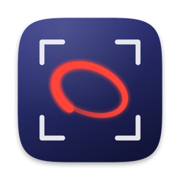
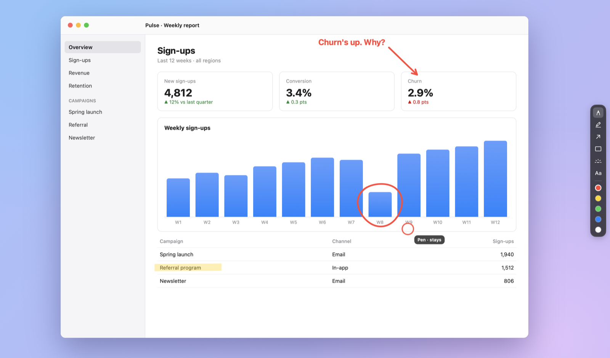
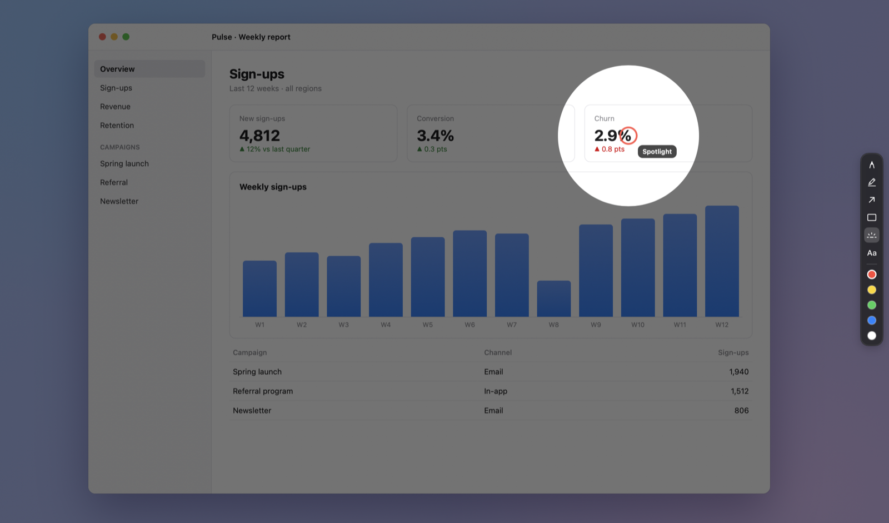
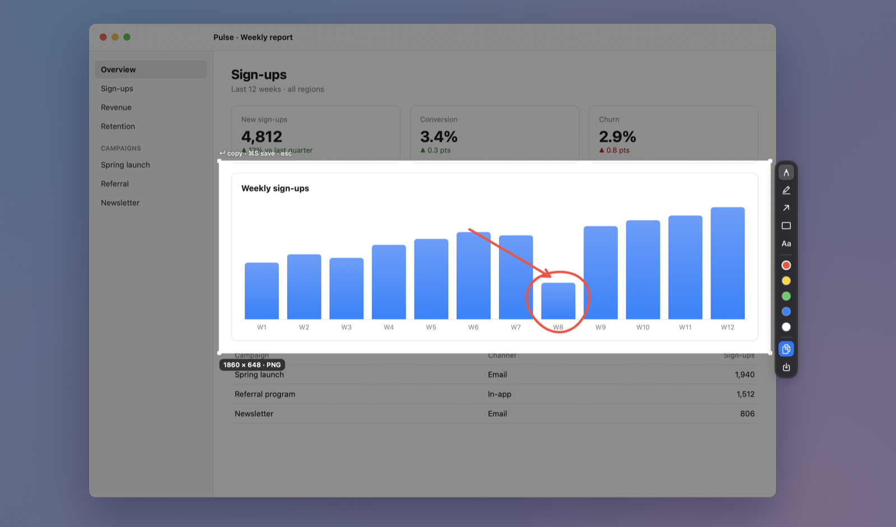

<div align="center">



# Tracer

**Draw on your Mac's screen to point things out, then screenshot what you marked up.**




</div>

Tracer lives in your menu bar. Press a hotkey and draw straight over whatever's running, with ink that fades on its own. Press it again and the mouse goes back to your apps.

A second hotkey freezes the screen so you can drag out a region and copy or save it at full Retina resolution, ink included. Nothing leaves your Mac.

## Install

Tracer needs macOS 27.

1. Download the latest `Tracer-<version>.dmg` from [Releases](https://github.com/LeonardCooray/tracer/releases/latest).
2. Open it and drag **Tracer** into **Applications**.
3. Open Tracer from Applications.

Tracer is signed with a personal certificate rather than an Apple Developer ID, so macOS blocks the first launch. Click **Done** on that warning, then go to **System Settings › Privacy & Security**, scroll down to **Security** and click **Open Anyway** next to Tracer. You only need to do this once.

The first screenshot asks for **Screen Recording** permission. Updates are signed with the same certificate, so the permission carries over when you install a new version.

## Features

**Draw live over the screen**

- Six tools: pen, highlighter, arrow, rectangle, spotlight and text
- Ink fades after a few seconds, or hold Shift to keep a stroke
- A slim tool dock slides in from the screen edge and gets out of the way when you're not using it
- Works across multiple displays



**Capture a region**

- Freeze the screen, drag a selection, then copy or save
- Full Retina size, as PNG or JPEG
- Works mid-drawing, so your annotations land in the shot
- Redact hides anything sensitive under a solid block, filled with the average colour of whatever it covers. Nothing under the block survives in the copied or saved image
- The spotlight and cursor ring are for pointing live and never appear in screenshots



## Keys

| Key | What it does |
|---|---|
| ⌥⇧D | Turn the pen on or off (turning it off clears the ink) |
| ⌥⇧S | Capture a region (works while drawing, keeping the ink) |

**While drawing**

| Key | What it does |
|---|---|
| 1–6 | Pen, highlighter, arrow, rectangle, spotlight, text |
| Shift | Keep the current stroke instead of letting it fade |
| ⌘Z | Undo the last stroke |
| ⌘⇧Z | Redo (a redone stroke starts its fade again) |
| Delete | Clear everything (this can't be undone) |
| Esc | Stop drawing |

**While capturing**

| Key | What it does |
|---|---|
| 1–6 | Pen, highlighter, arrow, rectangle, redact, text |
| Return or ⌘C | Copy the selection |
| ⌘S | Save the selection to your folder |
| ⌘Z / ⌘⇧Z | Undo / redo |
| Esc | Cancel the capture |

## Settings

Open **Settings…** from the menu bar icon to change:

- Both hotkeys
- How long ink stays before fading (1 to 10 seconds, 3 by default)
- The save folder (`~/Pictures/Tracer` by default)
- Image format, PNG or JPEG
- Whether to show the cursor ring when you're not drawing
- Launch at login

The menu also shows which version you're running. **Check for Updates…** opens the latest release in your browser; Tracer itself never goes online.

## Permissions

Screenshots need **Screen Recording** permission. Drawing works without any permission at all.

Tracer never asks for Accessibility or Input Monitoring. The hotkeys use the system hotkey API.

## Build from source

You'll need macOS 27 and the Xcode Command Line Tools. Full Xcode isn't required.

```bash
scripts/bundle.sh        # builds and signs build/Tracer.app
open build/Tracer.app
```

macOS ties Screen Recording permission to the app's signature. Create the one-time self-signed certificate in [docs/signing.md](docs/signing.md) so the permission survives rebuilds. Without it, `bundle.sh` signs ad hoc and macOS asks again after every build.

## Tests

```bash
scripts/test.sh          # unit tests
```

Use `scripts/test.sh` rather than `swift test`. The Command Line Tools build sometimes loses the Swift Testing plugin path, and the script passes it explicitly. For the same reason, the app code avoids SwiftUI macros such as `@State`.

A debug build also has a smoke test that drives the real overlays:

```bash
scripts/bundle.sh --debug
build/Tracer.app/Contents/MacOS/Tracer --self-test live
```

The other suites are `tools`, `capture`, `redact`, `settings` and `displays`.

## Releasing

Bump `CFBundleShortVersionString` in `Resources/Info.plist`, merge to `main`, then from an up-to-date `main`:

```bash
scripts/release.sh --publish
```

That builds `build/Tracer-<version>.dmg`, tags `v<version>` and uploads the DMG to a new GitHub release with generated notes. Without `--publish` it only builds the DMG. It stops if the app isn't signed with `Tracer Local Signing`, since a differently signed update would lose people's Screen Recording permission.

The app icon is drawn in code by `scripts/icon.swift`. Run `swift scripts/icon.swift` after changing it to rewrite `Resources/AppIcon.icns`. It's drawn full bleed on purpose: macOS 26 and later apply their own rounded shape, and an icon that's already rounded gets shrunk into a grey tile.

## License

[MIT](LICENSE) © 2026 Leonard Cooray
